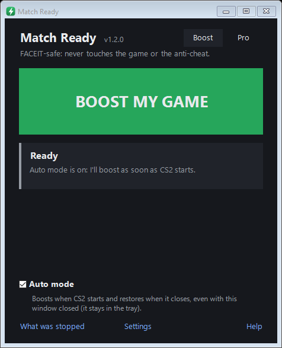
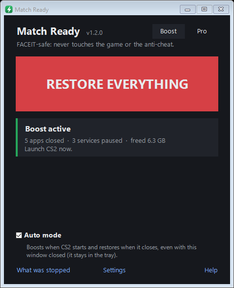
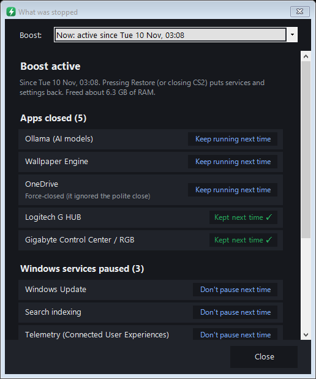
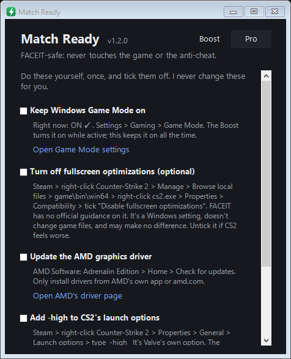

# Match Ready

**One button to get your PC ready for a CS2 match. FACEIT-safe: it never touches the game or the anti-cheat.**

Match Ready closes background apps that eat RAM, CPU or graphics memory, pauses noisy Windows services (Windows Update, search indexing, telemetry), switches to the High performance power plan, and puts **everything back** when you're done. With Auto mode it does all of this by itself: it boosts when CS2 starts and restores when CS2 closes.

[](https://github.com/onlyilir/match-ready/actions/workflows/build.yml)

> Match Ready is an independent, free tool. It is **not affiliated with, endorsed by, or connected to Valve, Counter-Strike or FACEIT.**

<p align="center">
  
  
</p>

## Download

Get **`MatchReady-Setup.exe`** from the [latest release](https://github.com/onlyilir/match-ready/releases/latest), run it and click **Install**. No admin is needed to install, and nothing else needs installing (Windows 10 22H2 or Windows 11, 64-bit).

Prefer no installer? Download **`MatchReady.exe`** from the same release and run it from anywhere.

**"Windows protected your PC"?** The app isn't code-signed yet, so Windows doesn't recognise it. Click **More info**, then **Run anyway**. Every release lists the SHA256 of each file, so you can check your download:

```powershell
Get-FileHash .\MatchReady-Setup.exe -Algorithm SHA256
```

## How to use it

1. Open **Match Ready** and click **Yes** on the Windows admin prompt. It needs admin rights to pause Windows services.
2. The first time, **Quick setup** asks a few questions and shows what it found on your PC: where you queue for FACEIT, whether you record with OBS, how much it should do (Full or Light), and which mouse, keyboard, headset or fan software to keep running.
3. Press **BOOST MY GAME**, or just start CS2 with **Auto mode** on.
4. When CS2 closes, it waits 30 seconds (in case CS2 is only restarting), then puts everything back.

Closing the window keeps Match Ready in the **tray** so Auto mode keeps working. The bolt icon is green while a boost is on and gray when idle. Right-click it for Boost, Auto mode and **Exit** (Exit restores everything first).

## What it does

| | Full profile | Light profile |
|---|---|---|
| Close heavy apps (AI model runners, wallpaper engines, benchmarks) | ✓ | ✓ |
| Close cloud sync, game launchers (never Steam), chat apps, remote access, Windows extras | ✓ | |
| Ask first, or never close, browsers and OBS | ✓ | ✓ |
| Pause Windows Update, search indexing, background downloads, telemetry, print spooler (only if nothing is printing), SysMain (SSD only) | ✓ | |
| High performance power plan, Windows Game Mode on | ✓ | ✓ |
| Pause notifications (off by default, so FACEIT "match found" alerts still come through) | optional | optional |

When you restore, services and settings go back exactly as they were. Closed apps **stay closed** until you open them yourself or restart the PC, so nothing pops up after you play (you can turn reopening on in Settings).

- **What was stopped** lists exactly what each of the last 10 boosts did, with a **Keep running next time** button on every app and service.
- **Settings** lets you search, add any running app to the close list, or untick anything.
- **Help** has a one-click **self-check** that proves restore puts everything back, plus **Copy log** for asking for help.
- The **Pro** tab is a checklist of things worth doing yourself once (Game Mode, GPU driver, `-high` launch option, FACEIT's AMD HPET fix).

<p align="center">
  
  
</p>

## What it will never do

- Touch CS2, Steam, FACEIT or any anti-cheat: no reading or writing their memory or files, no priority or affinity changes, not even opening a handle to them. It only reads the list of running program names, like Task Manager does.
- Change game files, configs or launch options.
- Load drivers, overlays or anything into other programs.
- Turn off Windows Security, Defender, the firewall, Secure Boot, TPM or VBS.
- Close Discord, antivirus, audio, network or graphics-driver software, or **any program that isn't on its list**.
- Make permanent changes. Services are only paused (a reboot brings them back), and every change is written to disk **before** it happens. If the app crashes or is killed mid-boost, it puts everything back the next time it starts.
- Connect to the internet, unless you click **Check for updates** or turn on the daily check. That only asks GitHub for the newest version number.

How each of these is enforced and tested: [docs/FACEIT-NOTES.md](docs/FACEIT-NOTES.md) and [SECURITY.md](SECURITY.md).

## Honest expectations

On a strong PC you'll mostly notice **steadier frame times and fewer background hiccups**, not big FPS jumps. The biggest wins come from closing heavy apps (local AI models, wallpaper engines) and on PCs with 8–16 GB of RAM. Match Ready shows how much RAM each boost freed.

## If something looks wrong

Press **RESTORE EVERYTHING**, or reboot: nothing is permanent. Then open **Help → Copy log** and include it when you [open an issue](https://github.com/onlyilir/match-ready/issues). Everything the app does is written to `%LOCALAPPDATA%\MatchReady\log.txt`.

**No tool can promise you'll never be banned.** Match Ready is built so it never interacts with the game or FACEIT, and its source is here for anyone to check. If FACEIT ever shows a warning about it, stop using it and open an issue.

## Uninstall

**Settings → Apps → Installed apps → Match Ready → Uninstall.** If a boost is still on, the uninstaller puts everything back first.

**Upgrading from "CS2 Booster"** (the old name): just run the new Setup. It moves your settings over and removes the old app.

## Command line

| Command | What it does |
|---|---|
| `MatchReady.exe --dry-run` | Prints what a boost would do. Changes nothing, no admin needed. |
| `MatchReady.exe --state` | Prints the current services, power plan and settings as JSON. |
| `MatchReady.exe --self-check` | Boosts services and settings (no apps), restores, and reports PASS or FAIL. Needs admin. |
| `MatchReady.exe --boost` / `--restore` | Boost or restore without the window. Needs admin. |
| `--out FILE`, `--data-dir DIR` | Also write output to FILE; use DIR instead of `%LOCALAPPDATA%\MatchReady`. |

## Build from source

Needs the [.NET 8 SDK](https://dotnet.microsoft.com/download/dotnet/8.0) on Windows.

```powershell
dotnet test MatchReady.sln                                         # 220+ tests
powershell -ExecutionPolicy Bypass -File build\Build-Setup.ps1     # dist\MatchReady-Setup.exe + dist\MatchReady.exe
```

Project layout: `src/MatchReady` (the app: `Safety/` protected list and guard, `Boost/`, `Restore/` crash-safe journal, `Sys/` all Windows calls, `UI/`), `installer/` (Setup and Uninstall, .NET Framework 4.8, which ships with Windows), `tests/`, `tools/`. See [CONTRIBUTING.md](CONTRIBUTING.md).

## License

[MIT](LICENSE) © 2026 onlyilir
